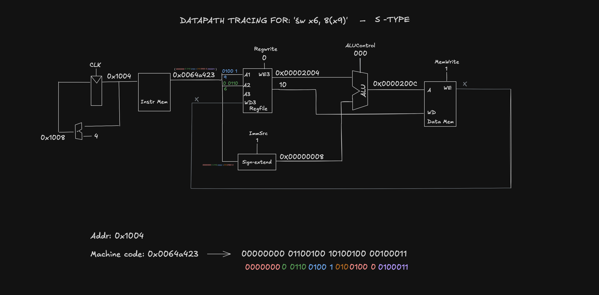
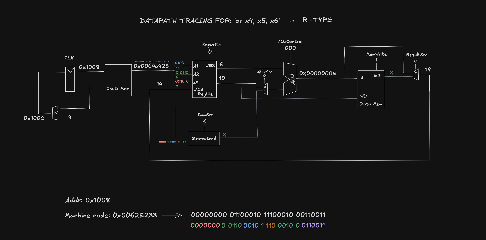
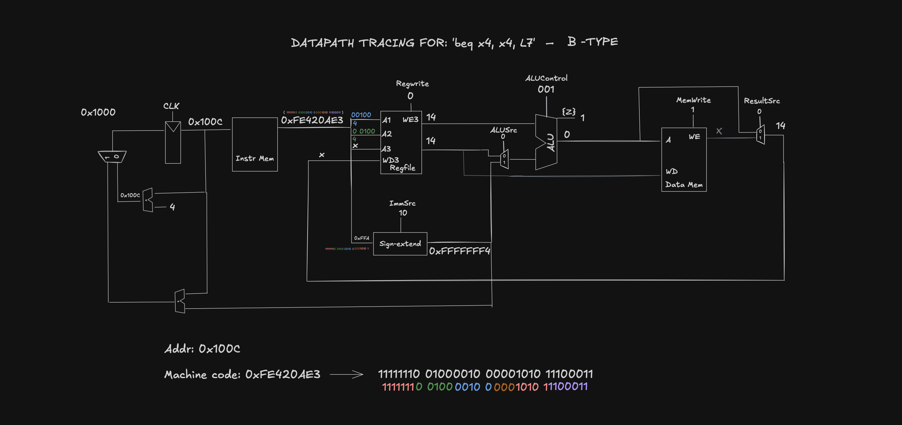

# Datapath Extensions (sw, R-type, beq)

Added sw, the R-type instructions, and beq. The goal each time is to change as little as possible.

## sw

sw is S-type. The first half is the same as lw: read the base register through port 1, sign-extend the immediate, and let the ALU add the two to get the address.

What's different:

- The 12-bit immediate is split. It lives in Instr[31:25] and Instr[11:7], not Instr[31:20]. The Extend unit now takes Instr[31:7], and a control signal, ImmSrc, picks which bits to use. ImmSrc = 0 for lw, 1 for sw.
- sw also needs a second register. rs2 (Instr[24:20]) goes to A2 on the register file. RD2 goes to the write data input (WD) of data memory.
- Control signals: MemWrite = 1, RegWrite = 0, ALUControl = 000 (add).

Data memory still does a read at that address during sw. The result just gets ignored because RegWrite = 0.

Example: PC = 0x1004, instruction 0x0064A423. x9 holds 0x2004 and x6 holds 10. The offset is 8, so the ALU computes 0x2004 + 8 = 0x200C. Memory writes 10 to 0x200C. PC becomes 0x1008.

## Examole Sketch -

## R-type (add, sub, and, or, slt)

Every R-type instruction does the same thing: read two registers, run the ALU, write the result back. They only differ in the ALU operation, so the hardware is shared and only ALUControl changes.

| Instruction | ALUControl |
| ----------- | ---------- |
| add         | 000        |
| sub         | 001        |
| and         | 010        |
| or          | 011        |
| slt         | 101        |

Two muxes get added:

- ALUSrc picks the second ALU input (SrcB). 1 selects ImmExt (lw, sw). 0 selects RD2 (R-type).
- ResultSrc picks what gets written back to the register file. 0 selects ALUResult (R-type). 1 selects ReadData (lw). It doesn't matter for sw since sw doesn't write a register.

Example: PC = 0x1008, instruction 0x0062E233 (or). x5 holds 6 and x6 holds 10. ALUControl = 011, so the ALU computes 0110 | 1010 = 1110 = 14. The result goes to x4. PC becomes 0x100C.

## Examole Sketch -

## beq

beq compares two registers. If they're equal, it adds the branch offset to the PC.

- The offset is a 13-bit signed value stored in 12 bits. Bit 0 is always 0 because instructions are at least 2-byte aligned, so it isn't stored. The Extend unit needs a third mode, so ImmSrc grows to 2 bits: 00 for lw, 01 for sw, 10 for beq.
- A new adder computes PCTarget = PC + ImmExt.
- The ALU subtracts SrcA - SrcB (ALUControl = 001, ALUSrc = 0). If the result is 0, the Zero flag goes high, which means the registers are equal.
- A new mux on PCNext picks PCTarget when the instruction is a branch and Zero is high. Otherwise it picks PCPlus4.
- RegWrite = 0 and MemWrite = 0.

Example: PC = 0x100C, instruction 0xFE420AE3. Both source registers are x4, which holds 14. The ALU computes 14 - 14 = 0, so Zero = 1. The Extend unit produces 0xFFFFFFF4 (-12). PCTarget = 0x100C - 12 = 0x1000, so the processor branches back to the start of the code.

## Examole Sketch -

## What was new each time

| Instruction | What got added                                   |
| ----------- | ------------------------------------------------ |
| sw          | ImmSrc, a path from RD2 to data memory, MemWrite |
| R-type      | ALUSrc mux, ResultSrc mux                        |
| beq         | PCTarget adder, PCNext mux, a third ImmSrc value |

lw already needed the register file, ALU, Extend unit and data memory. Everything after that was a mux, a control signal, or one small adder.

## Why beq is the only one that needs the PC mux

Every other instruction here leaves PC at PC + 4. beq is the only one that can send the fetch loop somewhere else, so it's the only one that needs a second source for the next PC.
