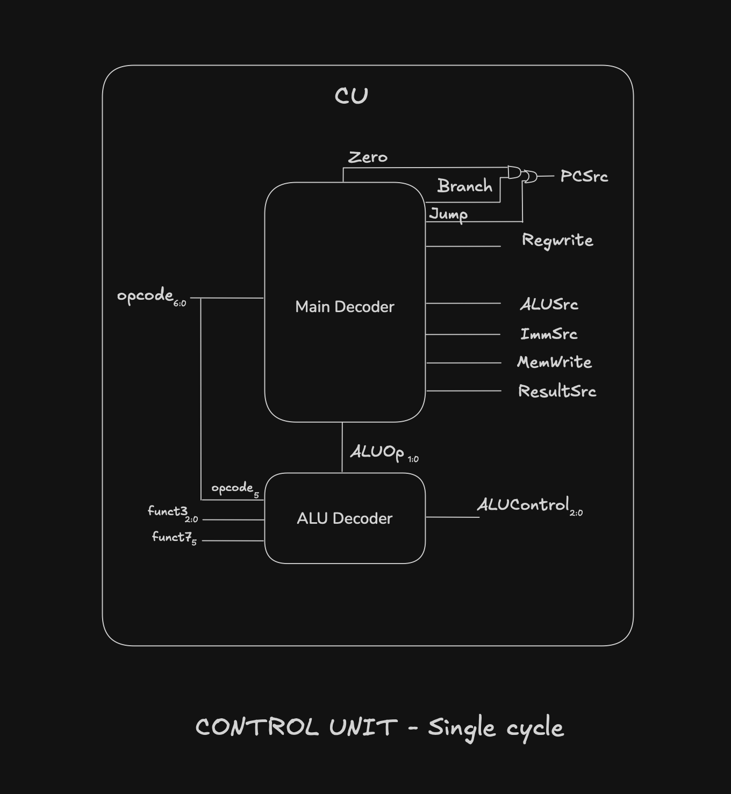

# 21: Single-Cycle Control

The datapath needs control signals. The control unit makes them from three things: op (Instr[6:0]), funct3 (Instr[14:12]) and one bit of funct7, Instr[30], which I'll call funct7[5].

Only funct7[5] is needed because the only place funct7 matters in this instruction set is add vs. sub. Both share the same op and funct3. The other six funct7 bits don't change anything.

## Two decoders

The control unit is split in two:

- **Main Decoder.** Looks at op only. It produces RegWrite, ImmSrc, ALUSrc, MemWrite, ResultSrc and Branch. It also produces ALUOp, which is internal and only goes to the ALU Decoder.
- **ALU Decoder.** Takes ALUOp, funct3, and sometimes op[5] and funct7[5], and produces ALUControl.

The Main Decoder never needs to know what and, or or slt are. It just knows "this is R-type" and passes that on as ALUOp.

## Main Decoder truth table

| Instruction | op      | RegWrite | ImmSrc | ALUSrc | MemWrite | ResultSrc | Branch | ALUOp |
| ----------- | ------- | -------- | ------ | ------ | -------- | --------- | ------ | ----- |
| R-type      | 0110011 | 1        | x      | 0      | 0        | 0         | 0      | 10    |
| lw          | 0000011 | 1        | 00     | 1      | 0        | 1         | 0      | 00    |
| sw          | 0100011 | 0        | 01     | 1      | 1        | x         | 0      | 00    |
| beq         | 1100011 | 0        | 10     | 0      | 0        | x         | 1      | 01    |

## ALUOp meaning

- 00: add (address calculation for lw and sw)
- 01: subtract (comparison for beq)
- 10: R-type, so look at funct3

## ALU Decoder

| ALUOp | funct3 | op[5], funct7[5] | Operation | ALUControl |
| ----- | ------ | ---------------- | --------- | ---------- |
| 00    | x      | x                | add       | 000        |
| 01    | x      | x                | subtract  | 001        |
| 10    | 000    | 00, 01, 10       | add       | 000        |
| 10    | 000    | 11               | sub       | 001        |
| 10    | 010    | x                | slt       | 101        |
| 10    | 110    | x                | or        | 011        |
| 10    | 111    | x                | and       | 010        |

## Example sketch

