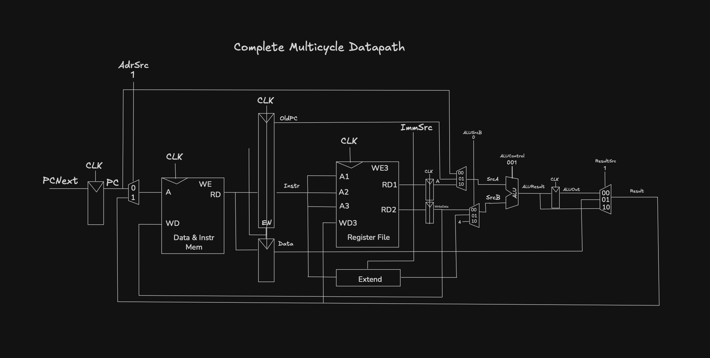
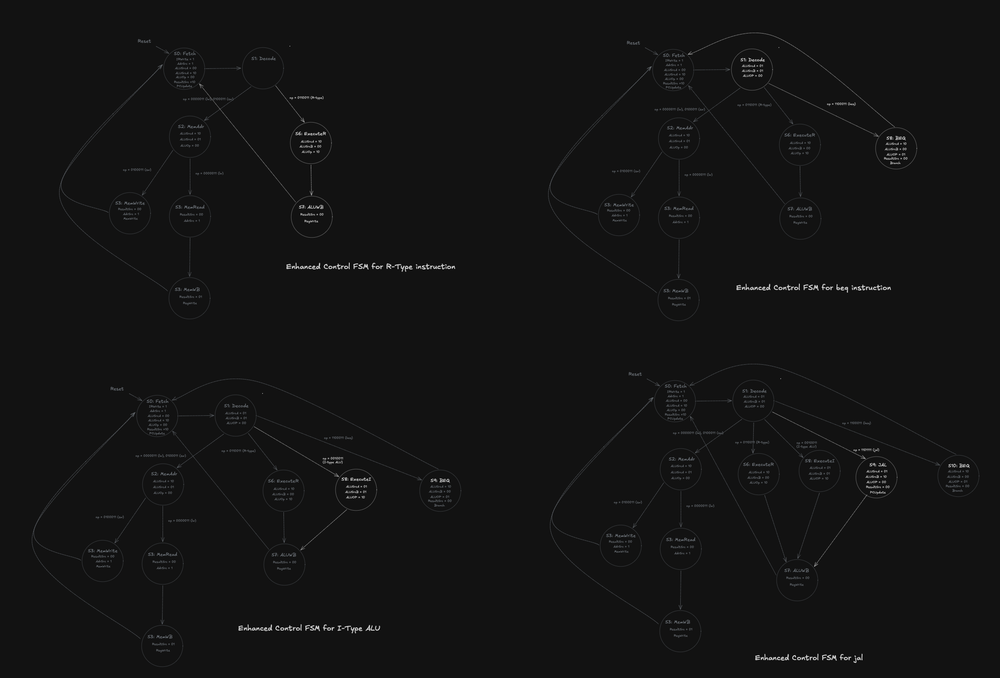

# 23: Multicycle Processor

The multicycle processor runs each instruction over several shorter clock cycles. Simple instructions take fewer cycles than complicated ones. Only one instruction runs at a time, but each one takes multiple cycles.

## Why it exists

Single-cycle makes every instruction as slow as the slowest one (lw). Multicycle was meant to fix that. It also reuses expensive hardware, like the adder and memory, across different cycles of the same instruction.

## Control is now a state machine

In the single-cycle processor, the Main Decoder is combinational: the same opcode always gives the same signals. In multicycle, one instruction needs different signals on different cycles, so the Main Decoder is replaced by a Main FSM.

It's a Moore machine, which means the outputs depend only on the current state. That's the same kind of FSM as the pattern detectors from chapter 4, just bigger.

The control unit has three parts:

- **Main FSM**: produces the sequence of control signals
- **ALU Decoder**: same as in single-cycle
- **Instr Decoder**: a small combinational block that produces ImmSrc from the opcode

## Nonarchitectural registers

State that exists only to make the implementation work, not part of what a RISC-V processor is. Programs can't see it. Multicycle needs it because something has to hold a value steady between clock edges. The ones named in the book's lw walkthrough:

- IR holds the fetched instruction
- OldPC holds the PC of the current instruction
- A and WriteData hold the two register values read in Decode
- ALUOut holds the ALU result
- Data holds the value read from memory

Single-cycle didn't need any of this because everything finished before the next clock edge.

## Example sketch

## The states for lw

| State   | What happens                                                       | Signals                                             |
| ------- | ------------------------------------------------------------------ | --------------------------------------------------- |
| Fetch   | Read the instruction from memory into IR. Save PC into OldPC.      | AdrSrc = 0, IRWrite = 1                             |
| Decode  | Read rs1 and rs2 into A and WriteData. Decode the instruction.     | none needed                                         |
| MemAdr  | ALU adds the base address and the offset. Result goes into ALUOut. | ALUSrcA = 10, ALUSrcB = 01, ImmSrc = 00, ALUOp = 00 |
| MemRead | Send ALUOut to memory as the address. ReadData goes into Data.     | ResultSrc = 00, AdrSrc = 1                          |
| MemWB   | Write Data to the destination register.                            | ResultSrc = 01, RegWrite = 1                        |

After MemWB the FSM goes back to Fetch.

## Example sketch

## The PC + 4 trick

The PC has to be incremented to fetch the next instruction. Instead of adding another state for that, the FSM does it during Fetch. The ALU isn't being used in that state, so it computes OldPC + 4 at the same time as the memory read.

During Fetch: ALUSrcA = 00 (the PC), ALUSrcB = 10 (the constant 4), ALUOp = 00 (add), ResultSrc = 10 (ALUResult), PCUpdate = 1.

## ALUSrcA and ALUSrcB got wider

Single-cycle only needed a 1-bit ALUSrc because SrcA was always the first register. In multicycle the ALU does a different job each cycle, so SrcA can be the PC (Fetch) or A (MemAdr). That's why ALUSrcA became a 2-bit select.

## Why multicycle ends up slower than single-cycle

With the book's assumptions, the multicycle processor is slower than the single-cycle one. Two reasons:

1. **The sequencing overhead is paid on every step.** The register clock-to-Q plus setup time is 90 ps. In single-cycle, lw pays it once. In multicycle, lw crosses five clock edges, so it pays it five times.
2. **The steps aren't equal in length.** The clock period has to fit the slowest step, so the cycle time doesn't shrink by anything close to a factor of five.

The book's general point: it's hard to exploit the fact that some computations are faster than others unless the differences are large.

## What multicycle does win on

Cost, not speed. It uses one shared memory for instructions and data, and it needs two fewer adders than single-cycle. The price is extra nonarchitectural registers and extra muxes.
