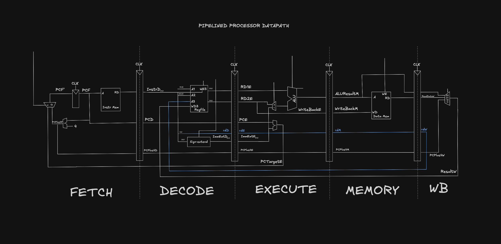
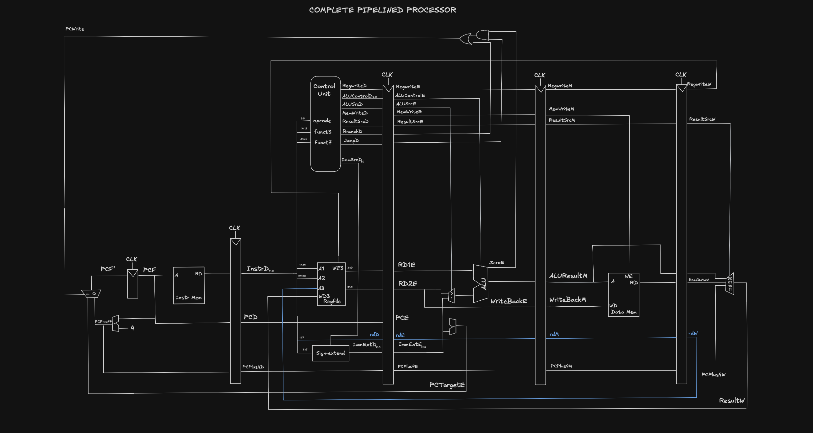

# 24: Pipelined Datapath and the Branch Hazard

The pipelined datapath is the single-cycle datapath cut into five stages, with a pipeline register between each pair of stages (four registers in total).

## The five stages

Signals get a suffix for the stage they belong to:

- **F**: Fetch
- **D**: Decode
- **E**: Execute
- **M**: Memory
- **W**: Writeback

So ResultW is the result in the Writeback stage, RdD is the destination register field in the Decode stage, and so on.

## Example sketch

## Everything for one instruction has to move together

In single-cycle there's only one instruction in the datapath, so Instr[11:7] is always the right destination register. In a pipeline there are five instructions in flight at once.

In the first version of the diagram, the register file write data comes from ResultW (Writeback stage), but the write address comes from RdD (Decode stage). When lw reaches Writeback in cycle 5, the instruction sitting in Decode is a different, later instruction. So lw's data would be written to that instruction's destination register (s5) instead of lw's own (s2).

The data is right. The address belongs to a different instruction.

The fix is to carry Rd through every pipeline register: RdD, then RdE, RdM, RdW. RdW and ResultW then go back to the register file together.

This is why pipeline registers get wider as you go down the stages. Anything an instruction will need later has to travel with it.

## Example sketch

## The register file writes on the falling edge

Everything so far changed state on the rising clock edge. In the pipelined processor, the register file writes on the falling edge instead.

That splits the cycle in half. An instruction in Writeback writes in the first half, and an instruction in Decode can read the updated value in the second half of the same cycle. This handles one specific case, an instruction reading a register that another instruction is writing in that same cycle, without extra hardware.

## Why pipelining works where multicycle didn't

The register overhead (clock-to-Q plus setup) is still paid at every stage, same as multicycle. The difference is that a new instruction enters the pipeline every cycle. One instruction still takes five cycles from start to finish, but in steady state one instruction finishes every cycle. That brings CPI close to 1 with a short clock period, which neither single-cycle nor multicycle managed.

## The branch hazard

The book points out a second problem: the logic for the next PC could be driven by a Fetch-stage signal (PCPlus4F) or an Execute-stage signal (PCTargetE).

Here's the problem. beq doesn't find out whether the branch is taken until Execute, when the ALU produces the Zero flag. By then, the two instructions behind it have already been fetched. One is in Decode and one is in Fetch, both from PC + 4 and PC + 8.

- If the branch is **not taken**, those two are the correct next instructions and nothing is wrong.
- If the branch is **taken**, they're from the wrong path. They must not be allowed to change any state (registers or memory).

This is a control hazard.

## The fix: flush

When the branch is resolved as taken, the two wrongly fetched instructions get flushed. Their pipeline registers are cleared so they turn into bubbles (harmless no-ops) and never reach a stage where they could write anything.
